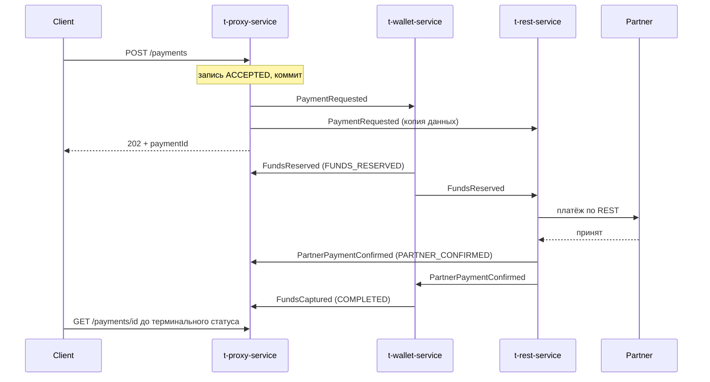
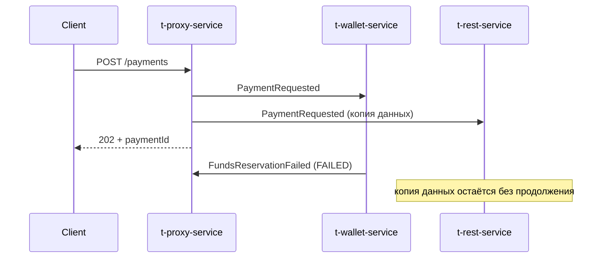
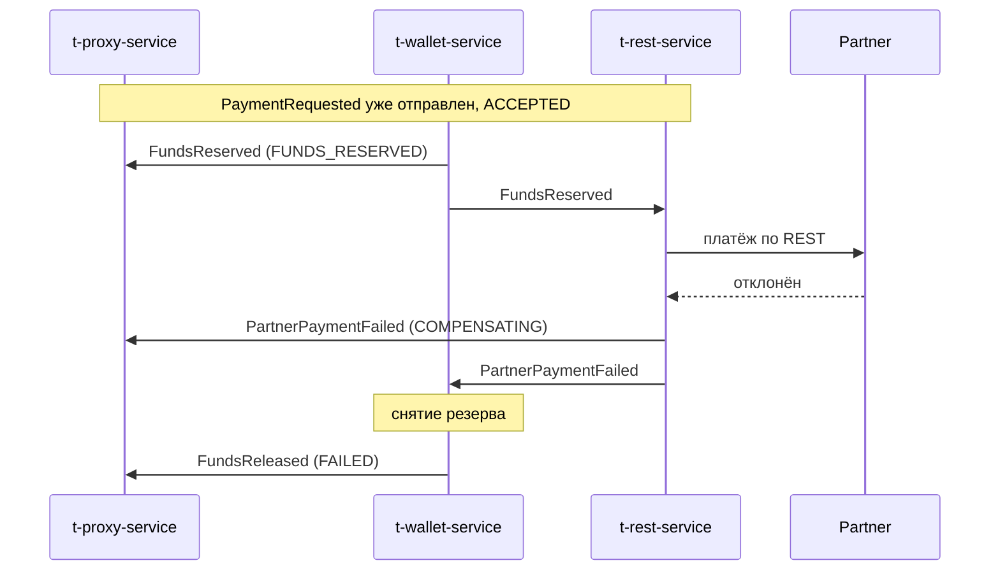
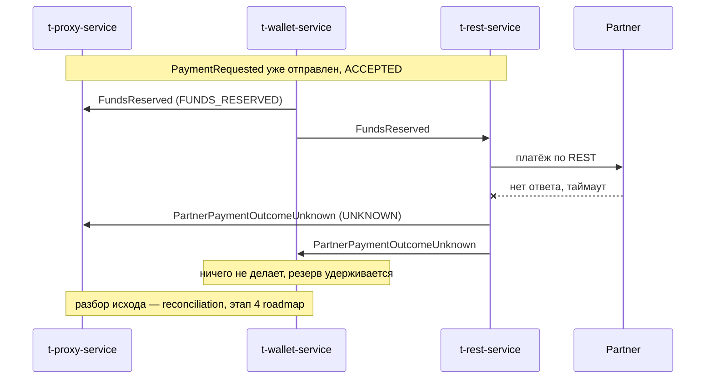
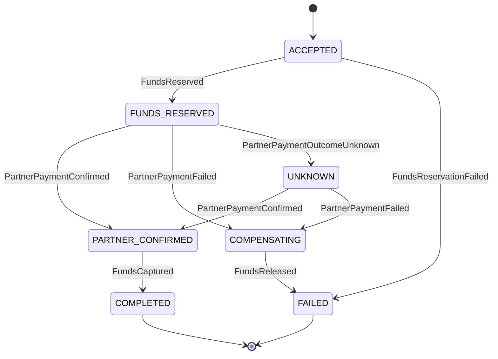

# Каталог событий (events.md)

Статус: принят (ревью пройдено 2026-11-22), шаг 3 плана `t-proxy-service`. Значения `reason` (раздел 4) и предварительные переходы из `UNKNOWN` (раздел 5) уточняются при проектировании wallet, rest-service и на этапе 4 roadmap.
Дата: 2026-11-22.

Связанные документы: `docs/adr/0002-event-publication-and-topics.md` (публикация событий, топики, ключи), план `t-proxy-service` (решения D3–D18), `services/t-proxy-service/src/main/resources/openapi/openapi.yaml` (внешний контракт).

## Решения, принятые при написании этого документа

| # | Решение | Статус |
|---|---|---|
| D12 | Добавлен промежуточный статус `COMPENSATING`: `PartnerPaymentFailed` → `COMPENSATING`, `FundsReleased` → `FAILED`. `FundsReservationFailed` → `FAILED` сразу (снимать нечего) | принято |
| D13 | Исход «неизвестен» от партнёра — отдельное событие `PartnerPaymentOutcomeUnknown` в `partner.events.v1` | принято |
| D14 | `causationId = null` у корневых событий (событий без события-причины); сейчас корневое одно — `PaymentRequested` | принято |
| D15 | Envelope вложенный: поля envelope отдельно, данные события в `payload` | принято |
| D16 | Суффикс топика (`v1`) — граница несовместимых изменений; `version` в envelope — версия схемы типа события | принято |
| D17 | `paymentId` дублируется в `payload` (помимо `correlationId` и ключа сообщения) | принято |
| D18 | rest-service подписывается на `payment.events.v1` и хранит собственную копию данных платежа (`accountNumber`, `serviceType`, сумма, валюта); `FundsReserved` не несёт чужих данных | принято |

## 1. Конвенции

| Тема | Правило |
|---|---|
| Имя события | PascalCase, прошедшее время, без префикса сервиса: `PaymentRequested`, `FundsReserved` |
| `type` в envelope | Равен имени события, без namespace |
| Топик | `<owner>.events.v1`, один владелец на топик (D8) |
| Ключ сообщения | `paymentId` как строка UUID, во всех трёх топиках (для wallet и partner подтверждается при проектировании этих сервисов) |
| Формат | JSON, UTF-8, поля в camelCase, enum строками |
| Время | ISO-8601 в UTC с `Z`, например `2026-11-22T17:48:31.512Z` |
| Деньги | `amountMinor` (целое, int64) + `currency` (ISO 4217), как в `openapi.yaml` |
| Идентификаторы | Генерируемые системой (`eventId`, `paymentId`, `correlationId`, `causationId`) — UUID строкой. Внешние идентификаторы (`customerId`, `accountNumber`) — произвольная строка, как в контракте |
| Потребитель | Tolerant reader: неизвестные поля игнорирует, не падает |
| Совместимые изменения внутри `v1` | Добавление необязательного поля. Удаление, переименование и смена типа запрещены |
| Несовместимые изменения | Новый топик `v2`; на время миграции публикуем в оба топика (D16) |
| Kafka headers | Только trace context (`traceparent`), добавляется в шаге 7. `type` и другие поля в headers не дублируем |

## 2. Envelope

Каждое сообщение — JSON-объект с envelope и вложенным `payload` (D15).

```json
{
  "eventId": "0b7f...-uuid",
  "type": "PaymentRequested",
  "version": 1,
  "correlationId": "5c1e...-uuid",
  "causationId": null,
  "occurredAt": "2026-11-22T17:48:31.512Z",
  "payload": { "paymentId": "5c1e...-uuid", "...": "..." }
}
```

| Поле | Тип | Обязательность | Смысл |
|---|---|---|---|
| `eventId` | UUID | да | Уникален для события; основа дедупликации (inbox, этап 3 roadmap) |
| `type` | string | да | Имя события |
| `version` | int | да | Версия схемы этого типа события, начинается с 1; растёт при совместимых добавлениях, информационное (D16) |
| `correlationId` | UUID | да | Равен `paymentId` |
| `causationId` | UUID | `null` только у корневых событий (D14) | `eventId` события, непосредственно вызвавшего это событие |
| `occurredAt` | instant | да | Момент, когда факт произошёл в сервисе-продюсере (не момент отправки в Kafka) |
| `payload` | object | да | Данные события; обязательно содержит `paymentId` (D17) |

## 3. События proxy (`payment.events.v1`)

### PaymentRequested

| Свойство | Значение |
|---|---|
| Владелец | `t-proxy-service` |
| Топик / ключ | `payment.events.v1` / `paymentId` |
| Природа | event: факт «платёж принят и записан» (D6); получатель proxy неизвестен |
| Корневое | да, `causationId = null` (D14): причина — HTTP-запрос, а не событие |
| Когда публикуется | После коммита транзакции с платежом `ACCEPTED`, синхронно (`acks=all`), до ответа `202` (D5) |
| Повторный запрос | Тот же `Idempotency-Key` и то же тело — событие **не** публикуется повторно (D5, D10) |
| `occurredAt` | Момент приёма платежа (равен `createdAt` платежа) |
| Читают | `t-wallet-service` (резервирование средств), `t-rest-service` (копия данных платежа, D18) |

Payload (поля берутся из `CreatePaymentRequest`, `X-Customer-Id` и сгенерированного `paymentId`):

| Поле | Тип | Обязательно | Источник / ограничения |
|---|---|---|---|
| `paymentId` | UUID | да | Генерирует proxy |
| `customerId` | string | да | Заголовок `X-Customer-Id`, 1–64 символа, не UUID |
| `accountNumber` | string | да | Тело запроса, 1–64 символа: лицевой счёт у поставщика услуги |
| `serviceType` | enum | да | `ELECTRICITY`, `WATER`, `GAS`, `HEATING`, `INTERNET` |
| `amountMinor` | int64 | да | Минимальные единицы валюты, ≥ 1 |
| `currency` | string | да | ISO 4217, три заглавные буквы |

Сознательно не включаем: `Idempotency-Key` (деталь входа proxy, значение клиента), `status` (всегда `ACCEPTED`), `createdAt` (совпадает с `occurredAt`).

Пример:

```json
{
  "eventId": "0b7f4a52-3c1d-4e8a-9b6f-2d1c7e9a8f10",
  "type": "PaymentRequested",
  "version": 1,
  "correlationId": "5c1e9d3a-7b24-4f6e-a1c8-90e5b3d7f412",
  "causationId": null,
  "occurredAt": "2026-11-22T17:48:31.512Z",
  "payload": {
    "paymentId": "5c1e9d3a-7b24-4f6e-a1c8-90e5b3d7f412",
    "customerId": "customer-1001",
    "accountNumber": "AZ-ELEC-0042",
    "serviceType": "ELECTRICITY",
    "amountMinor": 2550,
    "currency": "AZN"
  }
}
```

## 4. Входящие события (wallet, rest-service)

Эти события публикуют другие сервисы; здесь зафиксировано, что proxy (и соседи) ожидают от них. Реальные схемы окончательно подтверждаются при проектировании wallet и rest-service. Proxy из каждого события использует только `type` и `paymentId`; остальные поля payload нужны для аудита, reconciliation и других потребителей.

### Кто что читает

| Топик | Читают | Зачем |
|---|---|---|
| `payment.events.v1` | wallet | зарезервировать средства |
| `payment.events.v1` | rest-service | сохранить копию данных платежа (D18) |
| `wallet.events.v1` | proxy | обновить статус |
| `wallet.events.v1` | rest-service | `FundsReserved` — условие вызова партнёра |
| `partner.events.v1` | proxy | обновить статус |
| `partner.events.v1` | wallet | подтвердить (capture) или снять (release) резерв |

### Цепочка причин (`causationId`)

- `FundsReserved`, `FundsReservationFailed` → `eventId` события `PaymentRequested`.
- `PartnerPaymentConfirmed`, `PartnerPaymentFailed`, `PartnerPaymentOutcomeUnknown` → `eventId` события `FundsReserved` (логическая причина — резерв средств, даже если копия данных платежа дообработана позже).
- `FundsCaptured` → `eventId` события `PartnerPaymentConfirmed`.
- `FundsReleased` → `eventId` события `PartnerPaymentFailed`.

### `wallet.events.v1` (владелец `t-wallet-service`)

| Событие | Когда возникает | Payload (кроме `paymentId`) | Реакция других |
|---|---|---|---|
| `FundsReserved` | Средства клиента зарезервированы | `amountMinor`, `currency` | rest-service вызывает партнёра; proxy → `FUNDS_RESERVED` |
| `FundsReservationFailed` | Резерв невозможен | `reason` (enum: `INSUFFICIENT_FUNDS`, `WALLET_NOT_FOUND`, `CURRENCY_MISMATCH`) | proxy → `FAILED` |
| `FundsCaptured` | Резерв подтверждён в списание | `amountMinor`, `currency` | proxy → `COMPLETED` |
| `FundsReleased` | Резерв снят (компенсация) | `amountMinor`, `currency` | proxy → `FAILED` |

### `partner.events.v1` (владелец `t-rest-service`)

| Событие | Когда возникает | Payload (кроме `paymentId`) | Реакция других |
|---|---|---|---|
| `PartnerPaymentConfirmed` | Партнёр принял платёж | `partnerReference` (идентификатор операции у партнёра) | wallet делает capture; proxy → `PARTNER_CONFIRMED` |
| `PartnerPaymentFailed` | Партнёр отклонил платёж | `reason` (enum: `REJECTED`, `INVALID_ACCOUNT`) | wallet снимает резерв; proxy → `COMPENSATING` |
| `PartnerPaymentOutcomeUnknown` | Исход неизвестен (таймаут, нет ответа) | `reason` (enum: `TIMEOUT`) | wallet **ничего не делает**, резерв остаётся; proxy → `UNKNOWN`; разбор — reconciliation (этап 4 roadmap) |

Точный набор значений `reason` — черновик, уточняется при проектировании сервисов; consumers обязаны терпеть неизвестные значения enum.

### Последствия D18 (rest-service и две подписки)

- Порядок между топиками не гарантирован: rest-service может получить `FundsReserved` раньше, чем обработает `PaymentRequested`, хотя логически резерв наступает после запроса платежа.
- Предложение (не принято): rest-service вызывает партнёра, когда у него есть **оба** факта — копия данных платежа и `FundsReserved` — в любом порядке. Для этого нужна таблица с состоянием платежа и признаком «резерв получен».
- Для rest-service событие по неизвестному `paymentId` — не «игнорировать» (как у proxy, D9), а «запомнить факт и ждать вторую половину». Это отличие нужно проговорить при проектировании сервиса.
- Если резерв не удался (`FundsReservationFailed`), копия данных в rest-service остаётся без продолжения; очистка по сроку — отдельная тема (не в этом шаге).

## 5. Таблица «событие → статус»

Спецификация для read model в proxy (шаги 4 и 6). Статус платежа выводится только из событий wallet и rest-service (D3); `PaymentRequested` статус не меняет: платёж уже создан как `ACCEPTED` при приёме запроса.

### Статусы

| Статус | Смысл | Тип |
|---|---|---|
| `ACCEPTED` | Платёж принят и записан | начальный |
| `FUNDS_RESERVED` | Средства зарезервированы | промежуточный |
| `PARTNER_CONFIRMED` | Партнёр принял платёж, ждём списания | промежуточный |
| `COMPENSATING` | Партнёр отклонил платёж, резерв ещё не снят (D12) | промежуточный |
| `UNKNOWN` | Исход у партнёра неизвестен, резерв удерживается (D13); разрешается reconciliation | промежуточный |
| `COMPLETED` | Средства списаны | терминальный |
| `FAILED` | Платёж не состоялся, резерв снят или не создавался | терминальный |

### Матрица переходов

В ячейке — статус, в который переходит платёж, если событие пришло в данном текущем статусе. `—` — событие игнорируется как опоздавшее или дубль (лог DEBUG). `⚠` — событие противоречит текущему статусу: игнорируется, пишется WARN и растёт метрика противоречий (признак бага в соседнем сервисе или нарушения контракта).

| Событие \ текущий статус | `ACCEPTED` | `FUNDS_RESERVED` | `PARTNER_CONFIRMED` | `COMPENSATING` | `UNKNOWN` |
|---|---|---|---|---|---|
| `FundsReserved` | `FUNDS_RESERVED` | — | — | — | — |
| `FundsReservationFailed` | `FAILED` | ⚠ | ⚠ | ⚠ | ⚠ |
| `PartnerPaymentConfirmed` | `PARTNER_CONFIRMED` | `PARTNER_CONFIRMED` | — | ⚠ | `PARTNER_CONFIRMED` |
| `PartnerPaymentFailed` | `COMPENSATING` | `COMPENSATING` | ⚠ | — | `COMPENSATING` |
| `PartnerPaymentOutcomeUnknown` | `UNKNOWN` | `UNKNOWN` | — | — | — |
| `FundsCaptured` | `COMPLETED` | `COMPLETED` | `COMPLETED` | ⚠ | `COMPLETED` |
| `FundsReleased` | `FAILED` | `FAILED` | ⚠ | `FAILED` | `FAILED` |

Терминальные `COMPLETED` и `FAILED` не меняются никогда: любое событие в них игнорируется. WARN пишется, если событие противоречит итогу (например, `FundsCaptured` в `FAILED`); опоздавшее ожидаемое событие (например, `PartnerPaymentFailed` после `FAILED`, полученного от `FundsReleased`) — только DEBUG.

Переходы из `UNKNOWN` (колонка справа) предварительные: их окончательно определит reconciliation на этапе 4 roadmap.

### Правила применения

- **«Прыжки вперёд» допустимы:** порядок между топиками не гарантирован, поэтому из `ACCEPTED` можно перейти сразу в `PARTNER_CONFIRMED`, `COMPENSATING`, `UNKNOWN`, `COMPLETED` или `FAILED`.
- **Исходные статусы описываются явным списком, а не сравнением «рангов»:** ветви `PARTNER_CONFIRMED`, `COMPENSATING` и `UNKNOWN` между собой не упорядочены, линейная нумерация даёт неверные ответы.
- **Применение — один условный UPDATE:** в `WHERE` — `paymentId` и список допустимых исходных статусов для этого события. Ноль обновлённых строк — событие игнорируется; причину (неизвестный платёж, дубль, опоздавшее, противоречие) выясняет только логирование.
- **Дубли безопасны без inbox:** повторное событие приходит в уже достигнутый или более поздний статус и игнорируется. Таблица inbox нужна на этапе 3 roadmap не для корректности статуса, а для общей дисциплины consumer'ов.
- **Событие по неизвестному `paymentId`:** игнорируется с записью в лог (D9).

### Проверка достижимости

| Статус | Чем достигается |
|---|---|
| `ACCEPTED` | Создание платежа при `POST /payments` |
| `FUNDS_RESERVED` | `FundsReserved` |
| `PARTNER_CONFIRMED` | `PartnerPaymentConfirmed` |
| `COMPENSATING` | `PartnerPaymentFailed` |
| `UNKNOWN` | `PartnerPaymentOutcomeUnknown` |
| `COMPLETED` | `FundsCaptured` |
| `FAILED` | `FundsReservationFailed`, `FundsReleased` |

Каждый статус достижим, каждое входящее событие ведёт хотя бы в один статус.

## 6. Сценарии

На диаграммах стрелки между сервисами — события через Kafka (топики см. разделы 3 и 4). В скобках у событий proxy указан статус, в который платёж переходит.

### 6.1 Успех



### 6.2 Отказ wallet



### 6.3 Отказ партнёра и компенсация



### 6.4 Таймаут партнёра



### 6.5 Основные переходы статусов

Диаграмма показывает основные переходы; все допустимые «прыжки вперёд» и игнорируемые события — в матрице раздела 5.



Переходы из `UNKNOWN` предварительные (reconciliation, этап 4 roadmap).

### 6.6 Дубль и порядок не по очереди

Отдельной диаграммы не нужно, правило одно: в матрице раздела 5 повторное или опоздавшее событие не меняет статус. Пример: `FundsReleased` пришло раньше `PartnerPaymentFailed`. Платёж из `FUNDS_RESERVED` переходит сразу в `FAILED`, а опоздавшее `PartnerPaymentFailed` игнорируется как событие по терминальному статусу (DEBUG).

## 7. Известные ограничения

Всё ниже — сознательные упрощения текущего этапа, а не забытые места.

| Ограничение | Решение | Когда закрывается |
|---|---|---|
| Платёж может остаться в `ACCEPTED` без `PaymentRequested` (сбой между коммитом и публикацией) | D5, ADR-0002 | Этап 3 roadmap: Transactional Outbox; воспроизводится в упражнении шага 9 плана |
| Событие по неизвестному `paymentId` теряется из read model (только лог) | D9 | Этап 3 roadmap: DLT |
| Нет inbox, retry и DLT у consumer'ов; поведение при невалидном или «ядовитом» сообщении не определено | — | Этап 3 roadmap; простое поведение по умолчанию выбираем и записываем в шаге 6 плана |
| Статус `UNKNOWN` сам по себе не разрешается, резерв средств удерживается неограниченно долго | D13 | Этап 4 roadmap: таймауты и reconciliation |
| Если на `PaymentRequested` никто не отреагировал, платёж остаётся в `ACCEPTED` | ADR-0002 | Этап 4 roadmap: таймауты и reconciliation |
| Ключ партиционирования `paymentId` для `wallet.events.v1` и `partner.events.v1` — предложение | D8, открытый вопрос плана №2 | При проектировании wallet и rest-service |
| Копии данных платежа в rest-service не очищаются, если платёж не дошёл до партнёра | D18 | При проектировании rest-service |
| Схемы событий не проверяются машинно (JSON без schema registry); источник истины — этот документ | ADR-0002 | Тема №7 учебной программы: schema evolution, и contract tests (тема №10) |
| Значения `reason` в событиях — черновик | — | При проектировании wallet и rest-service |
| proxy знает семантику saga (какое событие считать финалом) | D3 | Этап 4 roadmap: пересмотр связности |
